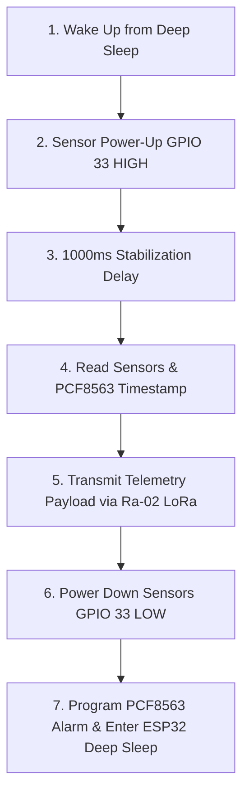

# AquaLoRa Slave Node Firmware

Production-grade Arduino/ESP32 firmware for the **AquaLoRa Slave Node** — a solar-powered water quality telemetry node equipped with high-side MOSFET power gating, ADC protection voltage dividers, DS18B20 1-Wire temperature compensation, PCF8563 RTC real-time clock timestamping, and Ra-02 (SX1278) LoRa RF communication.

---

## 1. Hardware Pinout & Protection Architecture

### 📍 ESP32 Pin Mapping Table

| Peripheral Subsystem | Pin Name | ESP32 GPIO | Description / Operating Range |
| :--- | :--- | :--- | :--- |
| **Power Switch Control** | `MOSFET_PIN` | **GPIO 33** | Output: Gate control for 2N7000 + IRF4905 MOSFET (`HIGH` = 5V ON, `LOW` = 5V OFF) |
| **pH Sensor** | `PH_PIN` | **GPIO 32** | Input: Analog (ADC1_CH4) via **10k/22k voltage divider** |
| **Turbidity Sensor** | `TURBIDITY_PIN` | **GPIO 35** | Input: Analog (ADC1_CH7) via **10k/22k voltage divider** |
| **TDS Sensor** | `TDS_PIN` | **GPIO 34** | Input: Analog (ADC1_CH6) Native 0–2.3V output range |
| **Temperature Sensor** | `ONE_WIRE_BUS` | **GPIO 4** | Digital: DS18B20 1-Wire on permanent 3.3V rail with 4.7k pull-up resistor |
| **RTC Data (SDA)** | `I2C_SDA` | **GPIO 25** | Hardware I2C SDA for PCF8563 RTC |
| **RTC Clock (SCL)** | `I2C_SCL` | **GPIO 26** | Hardware I2C SCL for PCF8563 RTC |
| **RTC Alarm Interrupt** | `RTC_INT_PIN` | **GPIO 27** | Hardware Interrupt Input (`ext0` active LOW wakeup from PCF8563 INT) |
| **LoRa Chip Select** | `LORA_NSS` | **GPIO 5** | SPI Slave Select / NSS |
| **LoRa Reset** | `LORA_RST` | **GPIO 16** | Hardware Reset Pin |
| **LoRa DIO0** | `LORA_DIO0` | **GPIO 17** | Digital I/O 0 Interrupt |
| **LoRa Clock (SCK)** | `LORA_SCK` | **GPIO 19** | Hardware SPI Serial Clock |
| **LoRa MISO** | `LORA_MISO` | **GPIO 18** | Hardware SPI Master In Slave Out |
| **LoRa MOSI** | `LORA_MOSI` | **GPIO 23** | Hardware SPI Master Out Slave In |

---

## 2. Voltage Divider ADC Protection Math

Sensors operating from the 5V rail (pH probe driver and optical turbidity module) can output analog signals up to **5.0V**. Because ESP32 ADC pins have a maximum safe input range of **3.3V**, a resistor voltage divider is placed between the sensor output and ESP32 pin:
- **$R_1$ (Top Resistor)**: $10\,\text{k}\Omega$
- **$R_2$ (Bottom Resistor to GND)**: $22\,\text{k}\Omega$

$$\text{Voltage Divider Ratio} = \frac{R_2}{R_1 + R_2} = \frac{22\,\text{k}\Omega}{10\,\text{k}\Omega + 22\,\text{k}\Omega} = \frac{22}{32} = 0.6875$$

At maximum 5.0V sensor output:

$$V_{\text{pin}} = 5.0\,\text{V} \times 0.6875 = 3.4375\,\text{V} \quad (\text{Safe for ESP32 ADC})$$

To reconstruct the true sensor module output voltage ($V_{\text{sensor}}$) inside firmware:

$$V_{\text{sensor}} = V_{\text{pin}} \times \left( \frac{R_1 + R_2}{R_2} \right) = V_{\text{pin}} \times \left( \frac{32}{22} \right) \approx V_{\text{pin}} \times 1.454545$$

---

## 3. Operational Duty Cycle (7-Step Lifecycle)



1. **Wake Up**: The ESP32 wakes up from deep sleep (`ext0` active LOW interrupt on GPIO 27 or internal timer fallback).
2. **Sensor Power-Up**: Drive GPIO 33 `HIGH` to switch ON the 2N7000 + IRF4905 MOSFET, energizing the 5V sensor rail.
3. **Stabilization Delay**: Wait mandatory 1000ms for op-amps and boost converter to warm up and stabilize.
4. **Data Acquisition**:
   - Sample DS18B20 digital temperature on GPIO 4.
   - Sample TDS on GPIO 34 (applying 2.0% per °C temperature compensation).
   - Sample Turbidity on GPIO 35 (applying $1.4545\times$ voltage divider scale to NTU polynomial).
   - Sample pH on GPIO 32 (applying $1.4545\times$ voltage divider scale).
   - Read current ISO date/time from PCF8563 RTC over I2C (`SDA=25, SCL=26`).
5. **LoRa Transmission**: Pack readings into telemetry payload string and transmit via Ra-02 LoRa over SPI (`SCK=19, MISO=18, MOSI=23, NSS=5`), then put radio to sleep (`LoRa.sleep()`).
6. **Power Down**: Drive GPIO 33 `LOW` to completely cut power to 5V sensors (< 1 µA leakage).
7. **Deep Sleep**: Arm PCF8563 countdown timer for next cycle (30 sec), configure ESP32 `ext0` wakeup on GPIO 27, and enter deep sleep.

---

## 4. Telemetry Payload Format

The node formats telemetry data as a comma-separated CSV string:

```text
Node1,2026-09-05T11:15:27Z,25.40,450,12.50,7.35
```

- **Field 1**: `Node1` (Unique Node Identifier)
- **Field 2**: `2026-09-05T11:15:27Z` (ISO 8601 RTC Timestamp)
- **Field 3**: `25.40` (Water Temperature in °C)
- **Field 4**: `450` (TDS in PPM)
- **Field 5**: `12.50` (Turbidity in NTU)
- **Field 6**: `7.35` (pH level 0.0–14.0)

---

## 5. File Structure

```text
AquaLoRa_SlaveNode/
├── AquaLoRa_SlaveNode.ino   # Main sketch orchestrating 7-step lifecycle
├── config.h                 # Central pin definitions, voltage divider constants & RF config
├── sensors.h                # Sensor sampling, oversampling & voltage divider reconstruction
├── rtc_driver.h             # PCF8563 I2C RTC driver, timestamp generator & ext0 alarm setup
└── lora_comms.h             # Ra-02 / SX1278 SPI LoRa driver & power-saving radio sleep
```

---

## 6. Dependencies & Libraries

Required libraries in Arduino IDE / PlatformIO:
- `SPI.h` (Built-in ESP32 core)
- `Wire.h` (Built-in ESP32 core)
- `LoRa` by Sandeep Mistry
- `OneWire` by Paul Stoffregen
- `DallasTemperature` by Miles Burton
